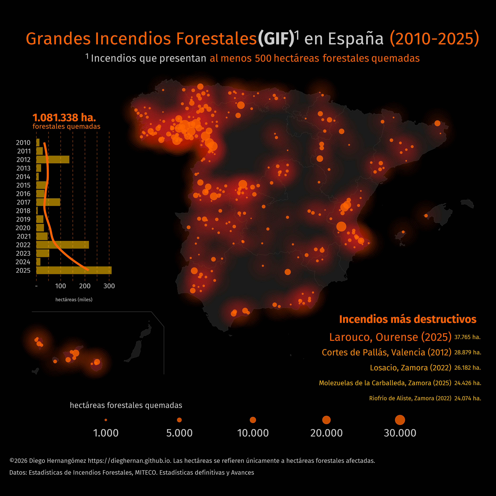

# Infografía de grandes incendios forestales

Este proyecto reúne los datos y el código en **R** utilizados para crear una
infografía de grandes incendios forestales (GIF) en España. En este contexto,
GIF se refiere a incendios con al menos 500 hectáreas forestales quemadas.

El conjunto actual contiene 404 registros fechados entre el 27 de febrero de
2010 y el 21 de septiembre de 2025. Estas fechas corresponden al primer y al último
registro del archivo, no a años completos de cobertura. El conjunto no es un
servicio de seguimiento de incendios en tiempo real.

El CSV incluye la provincia, el municipio y sus códigos, la fecha y la
superficie forestal quemada en hectáreas. Los códigos deben leerse como texto
para conservar los ceros iniciales.

[Descargar los datos en CSV](https://raw.githubusercontent.com/dieghernan/gifs/main/rdata/gif_d2010.csv).

La infografía se inspira en la técnica de cartografía de luciérnagas
presentada por Dominic Royé (<https://github.com/dominicroye>) en [Firefly
Cartography](https://dominicroye.github.io/blog/firefly-maps/).

## Fuentes de datos

Los datos proceden de las **estadísticas de incendios forestales** del
Ministerio para la Transición Ecológica y el Reto Demográfico (MITECO)
([Estadísticas del MITECO](https://www.miteco.gob.es/es/biodiversidad/temas/incendios-forestales/estadisticas-incendios.html)),
incluidas estadísticas definitivas y avances informativos. El conjunto
combina ambas fuentes sin identificar en cada registro si el dato es
definitivo o provisional.

<!-- FIXME: Confirmar por año qué datos son definitivos y cuáles provisionales. -->
El listado de GIF se recopila en `rdata/gif_d2010.xlsx`. El script
`incendios.R` lee ese archivo y exporta los registros a
`rdata/gif_d2010.csv`. Los códigos de provincia y municipio corresponden a la
codificación del INE
([Códigos de municipios del INE](https://www.ine.es/dyngs/INEbase/es/operacion.htm?c=Estadistica_C&cid=1254736177031&menu=ultiDatos&idp=1254734710990)).

Para situar los registros en el mapa, el script utiliza el código de municipio
para enlazarlos con las capitales municipales del paquete de **R**
[**mapSpain**](https://ropenspain.github.io/mapSpain/). Los puntos representan
esas ubicaciones de referencia, no el lugar exacto de inicio ni el perímetro
de los incendios. El tamaño de cada círculo refleja la suma de las hectáreas
forestales quemadas de los registros asociados a la misma ubicación. El
gráfico anual también resume únicamente los registros incluidos en el conjunto.

La información de la sesión con la que se ha generado la infografía se
proporciona en el archivo [sessioninfo.txt](sessioninfo.txt).

## Referencias

Royé, Dominic. 2021. «Firefly Cartography». 1 de junio de 2021.
<https://dominicroye.github.io/blog/firefly-maps/>.
