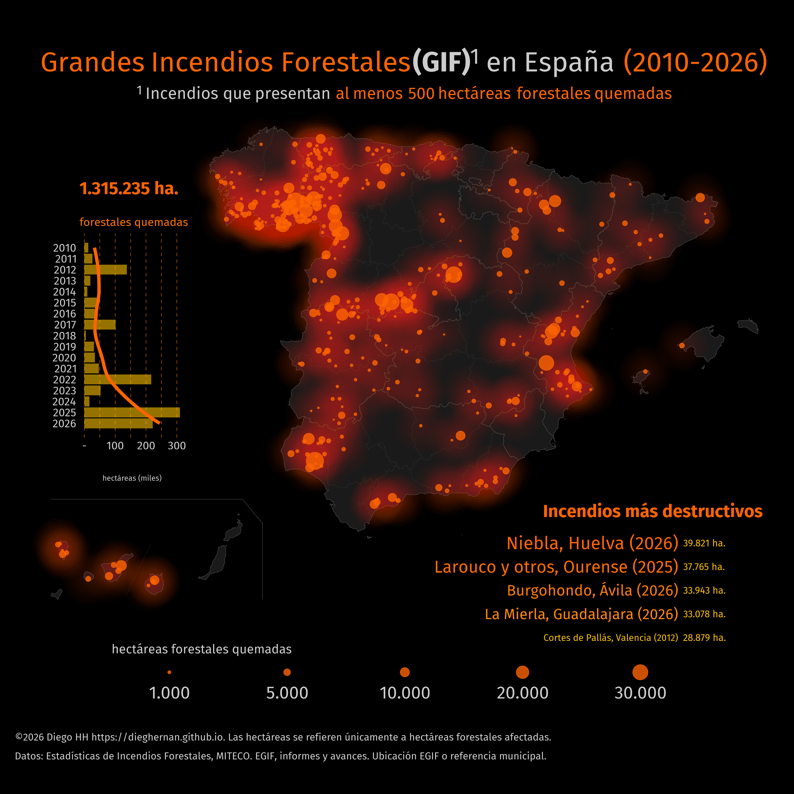

Este proyecto reúne datos estructurados de grandes incendios forestales
(GIF) en España, con al menos 500 hectáreas forestales quemadas, y el código
en R de la infografía.

La versión publicada **2.0.0** ofrece **329 partes EGIF de 2010–2023** y una
**vista conciliada de 455 registros de incendios de 2010–2026**. Los dos
archivos describen datos relacionados: no deben sumarse ni contarse sus
filas como si tuvieran la misma unidad. Hay 9 registros anteriores y
8 partes seleccionados cuya correspondencia sigue pendiente. Otros dos
registros se conservan con el avance oficial porque su provincia no tiene
partes en la exportación EGIF de 2023.

EGIF tiene prioridad cuando existe una correspondencia documentada. Los
registros sin correspondencia conservan su informe o avance de origen.
Las exportaciones no prueban cobertura anual completa. En 2023 no hay
registros de siete provincias. No es un servicio de seguimiento en tiempo real.





El producto principal, `rdata/egif_parts.csv`, contiene una fila por parte,
con `egif_part_id`, `fire_id` cuando está asignado, datos de origen,
superficies, causa, procedencia, notas y coordenadas. La vista
`rdata/gif_d2010.csv` conserva una fila por incendio registrado y sirve para
la infografía. Los identificadores y códigos deben leerse como texto. Ambos productos
se ofrecen también en JSON con tipos explícitos y valores nulos para datos
ausentes.

Ambos productos están disponibles en GeoJSON, con puntos en EPSG:4326 y
las mismas propiedades. Canarias conserva su ubicación real. Los registros
sin coordenadas interpretables permanecen con geometría nula.

Las columnas `longitude` y `latitude` utilizan **EPSG:4326**, sin desplazar
Canarias. `location_method` distingue las coordenadas EGIF de las capitales
municipales utilizadas como referencia. En partes sin datum conocido o sin
coordenadas, las coordenadas geográficas permanecen vacías. Los códigos
declarados y el municipio obtenido mediante cruce espacial se conservan
por separado. Cualquier corrección requiere revisión.

Los incendios con varios partes comparten `fire_id`. El umbral de 500 ha
se aplica a su suma después de las agrupaciones explícitas. Los partes
sin correspondencia permanecen sin `fire_id` y no se añaden automáticamente
a la vista de incendios, para evitar dobles recuentos.

## Fuentes y tratamiento

Los datos proceden de la [Estadística General de Incendios Forestales
(EGIF)](https://servicio.mapa.gob.es/incendios/Search/Publico) del MITECO y de
sus [informes y avances](https://www.miteco.gob.es/es/biodiversidad/temas/incendios-forestales/estadisticas-datos.html).
Los ZIP originales, descargados el 03/11/2026, se conservan con sus huellas
SHA-256. Los informes y avances de la base anterior se mantienen como
fuentes de respaldo identificadas por registro.

Origen de los datos: MITECO. Recopilación y adaptación: Diego HH. Los datos
se reutilizan conforme al [aviso legal del MITECO](https://www.miteco.gob.es/es/atencion-al-ciudadano/aviso-legal.html).
La licencia MIT corresponde al código y la documentación. El proyecto es
independiente y no implica respaldo del Ministerio. La cartografía municipal
y las capitales municipales proceden de IGN mediante SIANE y **mapSpain**.
Obra derivada de CartoBase ANE 2006-2024 CC-BY 4.0 ign.es.

La [metodología](https://github.com/dieghernan/gifs/blob/main/METODOLOGIA.md) y la [guía de datos](https://github.com/dieghernan/gifs/blob/main/data-raw/README.md)
describen la prioridad de fuentes, las agrupaciones y las limitaciones.
El archivo **Excel** anterior se conserva en `data-raw/legacy/` como
referencia histórica. Los CSV se regeneran con
`py scripts/build_dataset.py` y la infografía lee directamente su vista de
incendios. Véase [incendios.R](incendios.R).

Los puntos del mapa utilizan las coordenadas EGIF interpretables y una
capital municipal cuando no están disponibles. Son ubicaciones de
referencia, no perímetros. En incendios con varios partes, la vista de
incendios identifica el parte del que toma el punto de referencia.

La cita siguiente corresponde a la versión **2.0.0**, que incorporó la
migración a EGIF y está archivada en Zenodo.

<!-- citation:start; generated by scripts/citation.rb -->
## Cómo citar

> Hernangómez, D. (2026). *Grandes incendios forestales en España*
> (Version 2.0.0) [Data set].
> https://doi.org/10.5281/zenodo.23932940

<details markdown="1">
<summary>Referencia en BibTeX</summary>

```bibtex
@misc{hernangomez_grandes_incendios,
  author = {Hernangómez, Diego},
  title = {Grandes incendios forestales en España},
  year = {2026},
  version = {2.0.0},
  doi = {10.5281/zenodo.23932940},
  url = {https://doi.org/10.5281/zenodo.23932940},
  note = {Data set}
}
```

</details>

El [DOI general](https://doi.org/10.5281/zenodo.23929996) reúne las versiones del proyecto.
Para identificar los datos utilizados en un análisis, cite el DOI de la
versión correspondiente.
<!-- citation:end -->

## Referencias

Royé, Dominic. 2021. “Firefly Cartography.” June 1.
[https://dominicroye.github.io/blog/firefly-maps/](https://dominicroye.github.io/blog/firefly-maps/).
